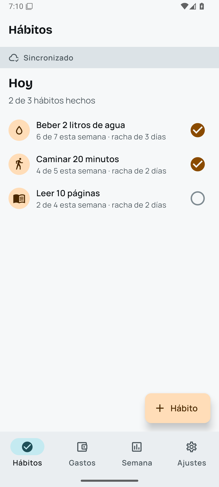
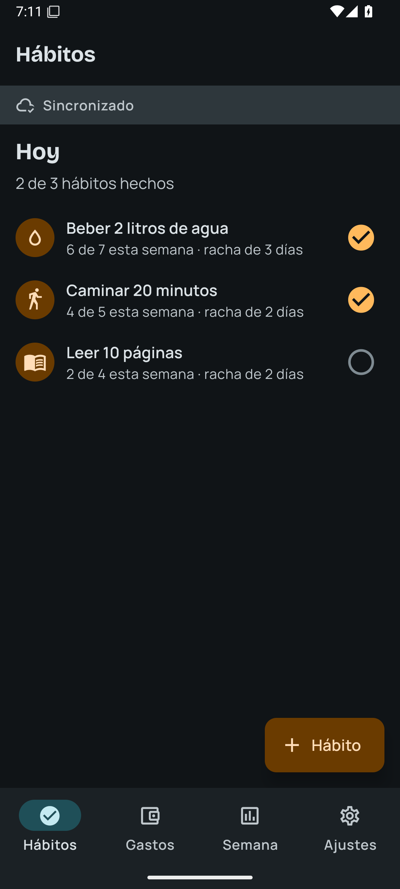
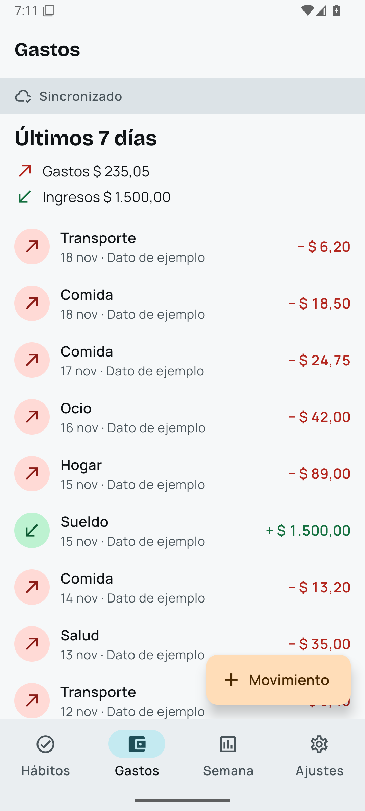
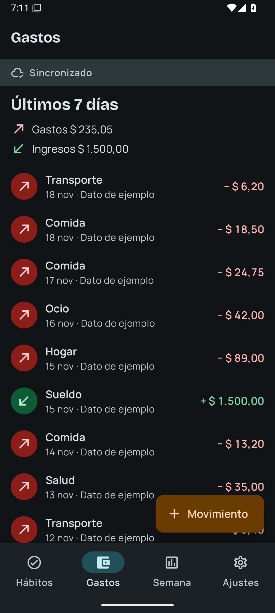
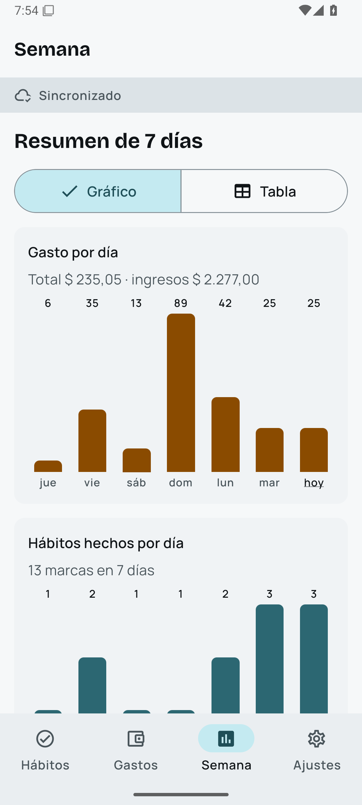
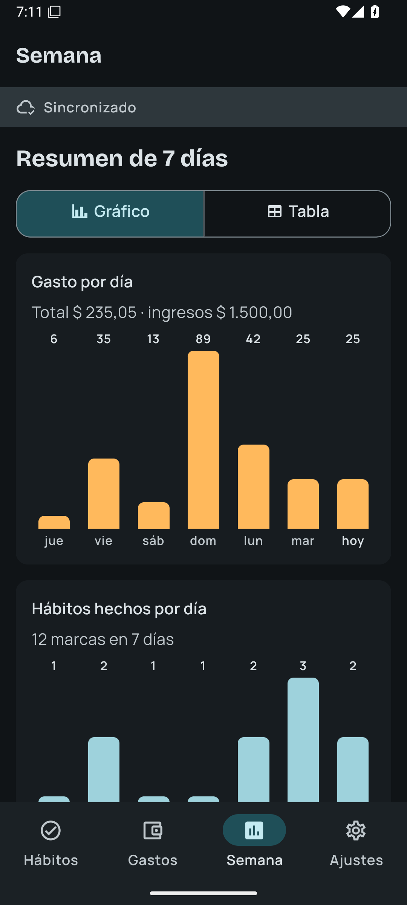
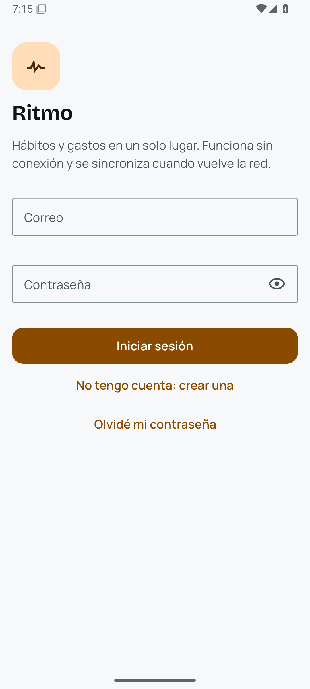
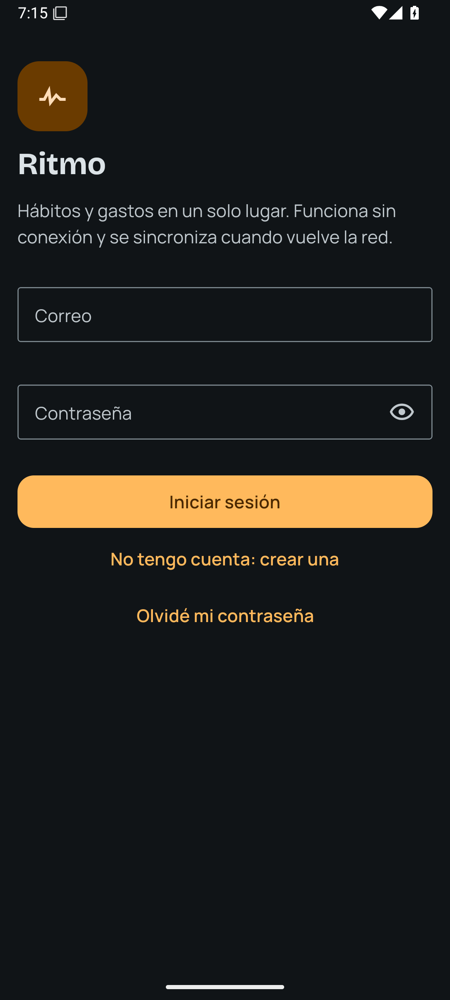

# Ritmo - hábitos y gastos que funcionan sin conexión

App móvil (Expo / React Native + Supabase) para llevar **hábitos diarios** y **gastos e ingresos** en un solo lugar.
Offline primero, sincroniza al volver la red, realtime, Material 3 con tema oscuro de primera clase y seguridad probada con tests (RLS con 2 usuarios).

> Todos los datos de las capturas son **ficticios** ("Dato de ejemplo", correos `@example.test`). Proyecto de portafolio; no es un producto publicado.

## Qué incluye

| Pieza | Estado |
|---|---|
| Android (APK release firmado con keystore local de prueba) | Construido, instalado y usado en **emulador** Android 15 (API 35, x86_64) |
| PWA (Expo web) | Construida y usada en navegador; demo pública en https://p06-ritmo-pwa.vercel.app (build contra el proyecto B; carpeta `site/`) |
| iOS | Configuración lista (`bundleIdentifier dev.ritmo.app`, `infoPlist`, esquema `ritmo`, mismo código, iconos vectoriales). La carpeta `ios/` **no se pudo generar**: Expo omite iOS en Windows ("Skipping generating the iOS native project files"); se genera con `npx expo prebuild -p ios` en macOS/Linux. **NO verificado** (no hay Mac ni EAS) |
| Backend | Supabase **local en Docker** (Auth + Postgres + PostgREST + Realtime) para desarrollar y probar RLS; migración lista para la nube |

Pantallas: login/registro/recuperar contraseña, **Hábitos** (lista, marcar hoy, racha), **Gastos** (lista, totales de 7 días), **Semana** (gráfico de barras con valores + alternativa de tabla), **Ajustes** (tema, datos de ejemplo, cerrar sesión, borrar mis datos), editores de hábito y movimiento (crear/editar/eliminar con Deshacer), estados vacío / carga (skeleton) / error / **offline** con indicador de sincronización.

## Cómo ejecutar

```powershell
# 1) Backend local (Docker; puertos 3160-3166; contenedores supabase_*_p06)
npm run db:start          # arranca y aplica supabase/migrations/p06_*.sql (idempotentes)

# 2) Tests (144)
npm run test:unit         # sin Docker
npm run test:rls          # requiere db:start; usa solo la clave anon
npm run typecheck

# 3) PWA
npm run build:web ; node scripts/serve-web.cjs 3168     # http://127.0.0.1:3168

npx expo prebuild --platform android --no-install ; node scripts/patch-android-signing.cjs
cd android ; .\gradlew.bat assembleRelease
```

Configuración: copia `.env.example` a `.env`. **Solo** `EXPO_PUBLIC_SUPABASE_URL` y `EXPO_PUBLIC_SUPABASE_ANON_KEY` (clave publishable). Para apuntar a la nube basta cambiar esas dos variables y recompilar.

## Evidencia: qué se midió y dónde

| Criterio | Resultado medido | Origen |
|---|---|---|
| Tests automáticos | **144 / 144 pasan** (123 unitarios + 21 de RLS/migración) | `npx vitest run` |
| RLS con 2 usuarios (REST) | B ve 0 filas de A; insert con `user_id` de A -> `42501`; update/delete de filas de A -> 0 filas y siguen intactas | tests/rls (Postgres+PostgREST reales) |
| RLS realtime | B no recibe ningún evento de A; A sí recibe los suyos (control positivo) | tests/rls |
| anon (sin sesión) | select vacío, insert denegado, RPC denegada, sin privilegios en tablas | tests/rls |
| Tabla nueva sin RLS | el test **falla** (meta-prueba: crea tabla sin RLS dentro de una transacción y comprueba que se detecta; igual para `using (true)`) | tests/rls/rls-coverage |
| Migración | idempotente (2 ejecuciones sin error), sin `drop`/`truncate`, sin tocar `auth.*`/`storage.*`, todo con prefijo `p06_` | tests/rls/rls-coverage |
| Supabase advisors (CLI local) | seguridad: **0 hallazgos**; rendimiento: **0 hallazgos** | `supabase db advisors` |
| clave de servicio / clave secreta | **0** en repo, en el bundle web (`dist/`) y en el APK (973 archivos escaneados; solo aparece la clave anon local) | `scripts/scan-artifacts.cjs`, test `security-static` |
| gitleaks | historial git: **0 fugas**. Árbol de trabajo (`gitleaks dir`): 5 coincidencias, todas en archivos **ignorados por git**: `.env` y bundle web (clave anon de demostración de Supabase local), `.env.cloud` (clave publishable), keystore de prueba | `gitleaks git` / `gitleaks dir` |
| semgrep (p/typescript, p/react, p/secrets) | 0 hallazgos | semgrep (reglas registradas) |
| APK | firmado (esquema v2 verificado con `apksigner`), `allowBackup` ausente (false), sin `debuggable`, sin cleartext en el release "cloud" | `apksigner`, `dumpsys package`, aapt2 |
| Objetivos táctiles | hábitos/gastos/semana/ajustes: 41 clicables medidos, todos **>= 48 dp** (filas 64 dp, bottom bar 80 dp, check 48 dp) salvo una fila de Gastos que el bottom bar tapa a medias (36 de 64 dp visibles; no es un objetivo pequeño). La primera medición detectó los botones segmentados de Paper en 40 dp y se reemplazaron por un componente propio de 48 dp; la segunda medición lo confirma | `uiautomator dump` + `scripts/measure-targets.cjs` en emulador |
| Contraste | 18 pares de texto >= 4.5:1 y 3 pares de UI >= 3:1, en claro y oscuro | tests/unit/design-tokens |
| Hex crudos fuera de `tokens.ts` | 0 (test falla si aparece alguno) | tests/unit/design-tokens |
| `font_scale` 1.3 | sin recortes: textos pasan a 2 líneas, FAB y barras intactos | emulador |
| Offline | con wifi/datos apagados: banner "Sin conexión, se guardará luego (1)"; al reconectar el servidor pasó de 2 a 3 registros del día | emulador + consulta SQL |
| Realtime en el dispositivo | una fila insertada en la base desde fuera aparece en la lista (captura `android-claro-realtime.png`) | emulador |
| Sesión | persiste tras cerrar y abrir la app (SecureStore); tras "Cerrar sesión" y reabrir, vuelve el login | emulador |

### Capturas reales del emulador (Pixel 6 AVD, 1080x2400)

| Claro | Oscuro |
|---|---|
|  |  |
|  |  |
|  |  |
|  |  |

`font_scale 1.3`: [hábitos claro](docs/capturas/android-claro-habitos-fs13.png), [gastos claro](docs/capturas/android-claro-gastos-fs13.png), [semana claro](docs/capturas/android-claro-semana-fs13.png), [hábitos oscuro](docs/capturas/android-oscuro-habitos-fs13.png).
Estados: [offline](docs/capturas/android-claro-offline-estado.png), [offline con 1 cambio pendiente](docs/capturas/android-claro-offline-pendiente.png), [reconectado](docs/capturas/android-claro-reconectado.png), [realtime](docs/capturas/android-claro-realtime.png), [editor + diálogo de borrado](docs/capturas/android-claro-editor-dialogo-eliminar.png), [ajustes](docs/capturas/android-claro-ajustes.png).
Alternativa de tabla del gráfico: [semana en tabla](docs/capturas/android-claro-semana-tabla.png). PWA (navegador, 390 px): [hábitos](docs/capturas/web-claro-habitos.jpg).

Todas las capturas salen de la compilación "local" instalada en el emulador (misma app; solo cambia la URL a Docker). Las de `font_scale` y modo oscuro son de una compilación anterior a los botones segmentados de 48 dp, al importe del editor con 2 decimales y al cierre de sesión solo local; `android-claro-semana*.png` y `android-claro-ajustes.png` ya son de la versión final.

## Seguridad (controles del checklist y su prueba)

1. **RLS en cada tabla** (`p06_habits`, `p06_habit_logs`, `p06_entries`): `enable` + `force`, 4 políticas por operación con `(select auth.uid()) = user_id` y `with check`; `user_id default auth.uid()` y el cliente nunca lo envía (test del outbox); `anon` sin privilegios. Un trigger fija `updated_at` en servidor y congela `user_id` en UPDATE; otro impide colgar un log de un hábito ajeno.
2. **Advisors 0** (CLI local). Sin vistas ni funciones `security definer` ejecutables por anon (test); `p06_delete_my_data()` es `security definer` solo para `authenticated`, con `search_path` vacío.
3. **Solo anon en el cliente**: `src/lib/env.ts` rechaza claves de rol distinto de anon y las clave secreta nueva; escaneo de repo/bundle/APK = 0.
4. **Sesión**: tokens en `expo-secure-store` (troceado), nunca en AsyncStorage; `Cerrar sesión` borra cache, outbox, dueño, `state` pendiente y cierra canales realtime; otra cuenta en el mismo dispositivo no hereda nada (test). Deep links: esquema único `ritmo://auth/callback`, `state` de un solo uso, PKCE, se rechazan tokens en el fragmento (6 tests).
5. **Realtime con RLS** probado con 2 usuarios. **Offline con re-autorización**: antes de sincronizar se valida el token en el servidor (`auth.getUser()`); sesión inválida o dueño distinto -> se borra todo lo local y no se envía el outbox; lo que el servidor rechaza por permisos se descarta y se avisa. Conflictos: marca de tiempo del servidor.
6. **Validación en servidor**: `check` de tipos/longitudes/rangos (importe 1..1e11 céntimos, nombre 1..60, `kind` en {gasto, ingreso}); probado.
7. **Android**: `allowBackup=false`, APK firmado, sin `console.log` de tokens (test), componentes exportados <= 1 (el launcher), HTTPS-only en el release cloud. La variante "local" permite HTTP **solo** a 127.0.0.1/localhost/10.0.2.2 (network_security_config) y no se entrega.
8. **Ciclo de vida**: `p06_delete_my_data()` borra los datos p06_ del usuario (probado). Storage: **no se usa** (sin buckets; el punto del checklist no aplica). PWA: no hay service worker, así que no se cachean respuestas autenticadas entre cuentas.

## Diseño

- Material 3 con `react-native-paper`: bottom bar de 4 destinos, **una FAB** por pantalla, top app bar, Snackbar con **Deshacer**, Dialog solo para borrar, Back del sistema vivo (Back en la raíz sale de la app; en editores vuelve), edge-to-edge con insets, `predictiveBackGestureEnabled`.
- Tokens en 3 capas (`src/theme/tokens.ts`): primitivos -> roles M3 claro/oscuro -> medidas de componente. Paleta propia ámbar + pizarra; ingreso/gasto con **icono + signo + color**. Fuentes Bricolage Grotesque (títulos y cifras) y Manrope (texto), instanciadas estáticas desde `recursos\tipografias` (OFL). Iconos `@expo/vector-icons` (MaterialCommunityIcons); cero emoji.

| Ítem | Resultado |
|---|---|
| Sin emojis como iconos; familia única de iconos | cumple (revisado en código) |
| Press feedback sin desplazar layout | `Pressable` + `android_ripple`, sin transformaciones |
| Tokens semánticos, sin hex en pantallas | cumple, **test automático** |
| Targets >= 48 dp | cumple, **medido** en emulador |
| Orden de foco / labels | roles `button/checkbox/radio`, `accessibilityLabel` en controles solo-icono; **TalkBack no probado** |
| Oscuro verificado aparte | contraste medido por tema + capturas en emulador |
| Texto grande (Dynamic Type) | `font_scale 1.3` en emulador |
| 375 px y apaisado | 390 px verificado (web); **apaisado y tablet NO verificados** |
| Reduced motion | no hay animaciones propias; con "Remove animations" del sistema no hay diferencia observable |

**Auto-auditoría `audit.native` de impeccable (revisión de código, sin las 57 compuertas de hallmark): 14/20.** Accesibilidad 3, Rendimiento 3 (lista virtualizada, **sin medir** jank ni 1000 filas), Tema 3 (sin Dynamic Color: solo esquema estático), Conformidad de plataforma 3, Adaptividad 2 (columna máx. 720 dp, sin layout específico de tablet/plegable).

## Límites honestos

- **Solo emulador.** No se probó en teléfono real (rendimiento táctil, teclado real, biometría de SecureStore).
- iOS sin verificar. PWA sin desplegar. TalkBack, apaisado y tablet sin probar.
- El indicador de red usa el endpoint de salud de Supabase (no un host de terceros): "offline" = no se llega al servidor.
- AsyncStorage no está cifrado: guarda datos de la app (no tokens). En PWA la sesión va a `localStorage` (no hay almacén seguro en web).
- El Security Advisor del **panel en la nube** no se ejecutó (la migración aún no está aplicada en el proyecto B); se usó el equivalente local de la CLI y el test de cobertura RLS.
- Licencias: dependencias directas MIT/Apache/BSD. Transitivas de herramientas de build de Expo con otras licencias libres (no van en la app): `lightningcss` (MPL-2.0), `caniuse-lite` (CC-BY-4.0), `big-integer`/`stream-buffers` (Unlicense), `node-forge` (BSD-3 o GPL-2.0, se usa BSD-3).

## Créditos y licencias

Expo, React Native, react-native-paper, react-navigation, supabase-js (MIT); Supabase CLI y servicios locales (Apache-2.0/MIT); Bricolage Grotesque (Mathieu Triay) y Manrope (Mikhail Sharanda), SIL OFL 1.1; iconos MaterialCommunityIcons (Pictogrammers, Apache-2.0). Icono de la app generado con código propio (`scripts/make-icons.py`).

## Caso de uso real

Una persona que usa el transporte público y a veces pierde señal: marca "Beber 2 litros de agua" y registra "Comida - $ 18,50" en el metro (sin conexión, queda "por enviar"), y al salir se sincroniza sola; el domingo mira "Semana" para ver qué día gastó más y cuántos hábitos cumplió, en claro o en oscuro, con la letra al 130 %.


## Rutas de la PC del autor
Algunos scripts de apoyo (compilación, base de datos, capturas) contienen rutas absolutas del equipo del autor (D:\ClaudeBrain\...). No son secretos, pero esos scripts no funcionarán en otra máquina sin cambiar las rutas. El código del proyecto y su sitio publicado no dependen de ellas.

